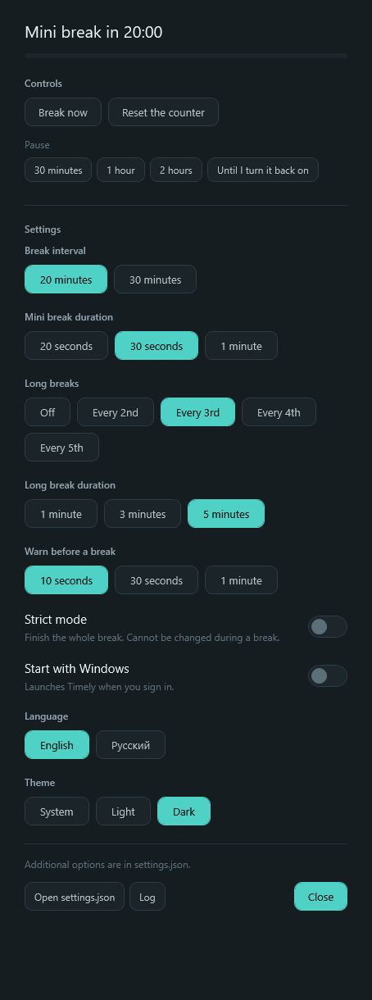

# Timely

A lightweight break reminder for Windows, built with WPF and .NET 10 LTS.
Timely runs in the system tray and displays a break window when it is time to rest.



## Download and run

The first release, **0.1.0**, is being prepared. Once published, download the ZIP
from [Releases](https://github.com/KFedor05/Timely/releases). You do not need to
download or build the source code to use the app.

1. Download `Timely-0.1.0-win-x64.zip` and extract the entire archive to a permanent folder.
2. Run `Timely.exe`. Find its icon in the Windows system tray, possibly under the
   hidden-icons arrow, and double-click it to open settings.
3. Choose your break interval and durations.

The package targets **Windows x64** and includes the .NET runtime. No separate
.NET installation, SDK, or administrator privileges are required.
Testing on a clean Windows 11 installation is still pending.
The executable is not digitally signed; Windows may display an unknown-publisher warning.

Closing the settings window leaves Timely running. To quit, choose **Exit** from
the tray menu. Running `Timely.exe` again opens the existing instance's window.

To update, exit Timely through the tray, then extract the new version into the
same folder. Settings are stored separately in `%APPDATA%\Timely`.
To uninstall, disable **Start with Windows**, exit Timely, and delete its folder.
You can also delete `%APPDATA%\Timely` to remove settings, timer state, and logs.

## How the timer works

By default, Timely starts a **30-second mini break after 20 minutes**, with a
**5-minute long break every third break**. The next interval begins when the
current break finishes or is skipped.

- The timer runs continuously. It does not monitor mouse or keyboard activity
  and does not try to detect whether you are at your desk.
- Reading, watching videos, stepping away, and locking Windows do not reset or pause it.
- Sleep and time between app launches also count. If a break is overdue,
  Timely shows one break on its next available tick, without a backlog of missed breaks.
- Only an explicit pause or an active break stops interval accumulation.
  Timed pauses expire automatically; indefinite pauses require **Resume**.
  Pauses are not preserved across app restarts.
- **Reset the counter** starts a fresh interval and resets the long-break cycle.
- Timer state is saved every 10 seconds and on normal exit. Settings and state
  use atomic file replacement, preserving the previous file if replacement fails.
- Errors during timer ticks are logged so the scheduler can keep running.

## Settings

| Setting | Options | Default |
|---|---|---|
| Break interval | 20 or 30 minutes | 20 minutes |
| Mini break duration | 20 seconds, 30 seconds, or 1 minute | 30 seconds |
| Long breaks | Off, every 2nd, 3rd, 4th, or 5th break | Every 3rd |
| Long break duration | 1, 3, or 5 minutes | 5 minutes |
| Warn before a break | 10 seconds, 30 seconds, or 1 minute | 10 seconds |
| Strict mode | On or off | Off |
| Start with Windows | On or off | Off |
| Language | English or Russian | Windows UI language, with English fallback |
| Theme | System, Light, or Dark | System |

Changing the **interval** starts a fresh countdown. Changing a **duration** applies
to future breaks and does not shorten or extend a break already in progress.
Changing the **long-break frequency** resets its cycle while keeping interval progress.
If long breaks are off, all breaks use the selected mini-break duration.
Disabling long breaks does not interrupt a long break already in progress.

The warning setting produces **one notification** at the selected lead time.
Changing it does not reset the countdown. Settings are saved automatically.

**Strict mode** requires the full break: Skip is hidden, Esc and Alt+F4 do not
close the break window, and tray Exit, pause, and reset cannot bypass the break.
The strict-mode switch is unavailable during a break. This is not a Windows lock:
Task Manager can still terminate the process, and the computer can still shut down.

Autostart uses the current user's Windows Run entry and respects known
StartupApproved disabled states. The switch refreshes when the window is activated.
An unknown approval record is treated as disabled. Startup does not re-enable an
entry disabled by the user; explicitly enabling the switch clears that override.

Language and theme changes apply immediately. In System theme, Timely follows
the Windows app theme.

## Advanced settings

Open `settings.json` from the app. It is stored in `%APPDATA%\Timely`, alongside
`state.json` and `timely.log`. Manual JSON edits take effect after restarting Timely.

| Key | Default | Meaning |
|---|---|---|
| `intervalMinutes` | 20 | Time between breaks, excluding explicit pauses |
| `miniBreakSeconds` | 30 | Mini-break duration; 20/30/60 available in the UI |
| `longBreakEvery` | 3 | Every Nth break is long; 0 disables long breaks |
| `longBreakMinutes` | 5 | Long-break duration; 1/3/5 available in the UI |
| `overlayScreenPercent` | 85 | Break-window width and height as a percentage of the primary screen |
| `allowSkip` | true | Show Skip and allow Esc in normal mode |
| `strictMode` | false | Require the full break; overrides `allowSkip` |
| `preNotifySeconds` | 10 | Notification lead time; 0 disables notifications |
| `language` | null | `"en"` or `"ru"`; null follows the Windows UI language |
| `theme` | `"system"` | `"system"`, `"light"`, or `"dark"` |

Legacy `presenceIdleMinutes`, `restCreditMinutes`, and `restRunMs` values are
ignored and removed on the next save.

## Privacy

Timely does not send telemetry or make network requests. Settings, timer state,
and diagnostic logs stay on your computer. Logs may contain your Windows
username and file paths; review them before attaching them to a public issue.

## Build from source

Requires Windows and **.NET SDK 10 x64**. `global.json` selects a stable .NET 10
SDK and excludes preview releases.

```powershell
dotnet build src/Timely/Timely.csproj -c Release
dotnet run --project tools/SchedulerSim/SchedulerSim.csproj -c Release
```

The executable is written to `src/Timely/bin/Release/net10.0-windows/Timely.exe`.

For an SDK installed in `%USERPROFILE%\.dotnet`, prepend that directory to PATH
in the current PowerShell session:

```powershell
$env:PATH = "$env:USERPROFILE\.dotnet;" + $env:PATH
```

The scenario runner uses virtual time to test scheduling, all duration and
frequency choices, explicit pauses, notification timing, strict mode, restart
behavior, atomic saves, startup-approval parsing, and legacy state.
It also checks WPF settings layout in small viewports in both languages and themes.
These checks do not replace testing on other computers and actual DPI settings.

## Create a release package

```powershell
./tools/Publish.ps1
```

The script finds SDK 10 in PATH or the standard per-user `.dotnet` directory.
It produces `dist/Timely-0.1.0-win-x64.zip` and a matching `.zip.sha256` file.
The ZIP includes the executable with its runtime, documentation, build metadata,
and application and runtime license notices.

Builds use a separate staging directory and do not replace a running copy.
The script refuses to overwrite an existing archive with the same version:
move the previous archive or update the version in `Timely.csproj` before rebuilding.

Verify the archive checksum:

```powershell
Get-FileHash .\dist\Timely-0.1.0-win-x64.zip -Algorithm SHA256
```

GitHub Actions builds, runs checks, and uploads a release-candidate artifact.
Public releases are published separately after validation.
See the [release checklist](docs/RELEASE.md) and [changelog](CHANGELOG.md).

The app icon can be regenerated from source:

```powershell
dotnet run --project tools/IconGen/IconGen.csproj -c Release -- src/Timely/timely.ico
```

## Known limitations

- The break window appears only on the primary monitor.
- There are no global hotkeys.
- Intervals other than 20/30 minutes require editing JSON.
- In normal mode, `allowSkip=false` hides Skip and disables Esc, but does not block Alt+F4.
- Actual clean-system, sign-in, and multi-monitor/DPI testing are still required.

## Report a bug

[Open an issue](https://github.com/KFedor05/Timely/issues) with the Timely version,
Windows version, display scaling, steps to reproduce, and expected and actual behavior.
Use **Log** in the app to find relevant diagnostic lines, removing personal paths first.

## License

Timely's source code is licensed under the [MIT License](LICENSE).
The bundled .NET components have separate license notices in the package's `licenses` folder.
